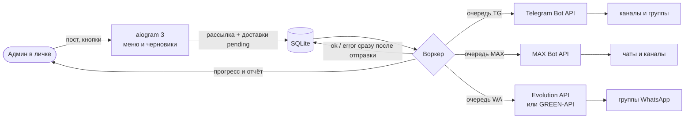

<div align="center">

# Crosspost Bot

**Один пост — в Telegram, MAX и WhatsApp одним нажатием.**
Telegram-бот мультирассылки для администраторов своих каналов и групп.

[](https://github.com/Rodrigo09313/crosspost-bot/actions/workflows/ci.yml)


[](LICENSE)

</div>

> **English.** Crosspost Bot is a self-hosted Telegram bot that cross-posts one text post to your
> own Telegram channels/groups, MAX chats and WhatsApp groups. Each network has its own queue,
> networks run in parallel, every send is persisted in SQLite, so a restart never duplicates or
> loses deliveries. WhatsApp goes through self-hosted [Evolution API](https://github.com/EvolutionAPI/evolution-api)
> or GREEN-API. Python 3.12, aiogram 3, httpx, Docker Compose; `mypy --strict`, 200+ tests.
> The interface is in Russian.

---

## Возможности

- **Три сети за раз.** Пишете боту пост в личку → предпросмотр с кнопками площадок → «Да».
  Пост уходит во все выбранные каналы и группы Telegram, чаты MAX и группы WhatsApp.
- **Своя очередь у каждой сети.** Telegram, MAX и WhatsApp идут параллельно и не ждут друг
  друга. Внутри сети — по одному чату со случайной паузой: рассылка выглядит как ручная.
- **Без дублей и пропусков.** Каждая доставка пишется в SQLite сразу после отправки.
  Перезапуск, обновление или падение сервера — рассылка продолжится с того же места.
- **Остановка по одной.** «⏹ Стоп» показывает список рассылок: остановить одну (остальные
  идут дальше) или все, с подтверждением. Кнопка «⏹ Остановить» есть и под прогрессом.
- **Всё настраивается в боте.** Чаты Telegram выбираются системным окном Telegram, чаты MAX и
  группы WhatsApp — галочками, токен MAX присылается сообщением. ID вписывать не нужно.
- **Статус и история таблицами** (rich-сообщения Telegram): площадки, проблемы с подсказкой,
  что делать, ход каждой рассылки.
- **Только для своих.** Бот отвечает лишь пользователям из `ADMIN_IDS`, остальным — тишина.
- **Работает на своём железе.** VPS или Raspberry Pi 4/5 (arm64), Docker Compose,
  без платных сервисов. Резерв для WhatsApp — GREEN-API, переключение одной переменной.

## Как это выглядит

```
Вы:   🔥 Акция до воскресенья: −20% на всё …

Бот:  [✅ Telegram (4)] [✅ MAX (2)] [✅ WhatsApp (195)]
      [🚀 Отправить] [✖ Отмена]

Бот:  Отправить в: TG 4, MAX 2, WA 195?
      Примерно 77 мин                                            [Да] [Нет]

Бот:  📤 Рассылка #14
      TG 4/4 ✅ · MAX 2/2 ✅ · WA 45/195                          [⏹ Остановить]

Бот:  🏁 Рассылка #14 завершена
      ✅ Telegram 4/4 чатов
      ✅ MAX 2/2 част.
      ❌ WhatsApp 193/195 групп
          ❌ Юг — HTTP 403: not-authorized
```

«📊 Статус» — таблица площадок, свёрнутый блок «⚠️ Проблемы» и таблица идущих рассылок
(«№ | Пост | TG | MAX | WA»). «🗂 История» — таблица последних 15 рассылок.

## Как устроено



- `app/bot` — обработчики aiogram: меню-панели, выбор чатов, черновики, «Стоп».
- `app/worker.py` — три дорожки (по одной на сеть), паузы, повторы, прогресс, отчёт, возобновление.
- `app/senders` — отправщики за одним Protocol; каждый знает только свою сеть.
- `app/storage.py` — SQLite (aiosqlite): рассылки, доставки, настройки из меню.
- `app/texts.py` — все строки интерфейса; `app/rich.py` — разметка rich-таблиц Telegram.

---

## Содержание

1. [Что понадобится](#1-что-понадобится)
2. [Установка](#2-установка)
3. [Привязка WhatsApp](#3-привязка-whatsapp)
4. [Куда рассылать: выбор чатов в меню](#4-куда-рассылать-выбор-чатов-в-меню)
5. [Проверка](#5-проверка)
6. [Работа с ботом](#6-работа-с-ботом)
7. [Бэкап и восстановление](#7-бэкап-и-восстановление)
8. [Обновление](#8-обновление)
9. [Переключение на GREEN-API](#9-переключение-на-green-api)
10. [Веб-менеджер Evolution API](#10-веб-менеджер-evolution-api)
11. [Надёжность и паузы](#11-надёжность-и-паузы)
12. [Образы и arm64](#12-образы-и-arm64)
13. [Частые проблемы](#13-частые-проблемы)
14. [Разработка](#14-разработка)
15. [Ответственное использование](#15-ответственное-использование)
16. [Лицензия](#16-лицензия)

---

## 1. Что понадобится

| Что | Где взять |
|---|---|
| Linux-сервер с Docker: VPS (1 vCPU, 2 ГБ) или Raspberry Pi 4/5 с **64-bit** ОС | `uname -m` → `x86_64` или `aarch64` |
| Токен Telegram-бота | @BotFather → `/newbot` |
| Ваш числовой Telegram ID | @userinfobot |
| Токен бота MAX (можно позже) | business.max.ru → «Чат-боты» → «Интеграция» → «Получить токен» |
| Отдельный «прогретый» номер WhatsApp | SIM + телефон с WhatsApp, номер состоит в целевых группах |

Стек целиком (бот + Evolution API + Postgres) занимает около 0,6–1 ГБ памяти.

## 2. Установка

Все команды выполняются на сервере по SSH.

### 2.1 Docker

```bash
curl -fsSL https://get.docker.com | sh
```

```bash
sudo usermod -aG docker $USER && sudo systemctl enable docker
```

Перезайдите по SSH, чтобы группа `docker` применилась. Автозапуск Docker поднимет контейнеры
после перезагрузки (`restart: unless-stopped`).

### 2.2 Код

```bash
git clone https://github.com/Rodrigo09313/crosspost-bot.git ~/crosspost-bot && cd ~/crosspost-bot
```

### 2.3 `.env`

```bash
cp .env.example .env
```

Сгенерируйте секреты (две строки — ключ Evolution и пароль Postgres):

```bash
openssl rand -hex 32; openssl rand -hex 24
```

Заполните в `.env` (`nano .env`):

| Переменная | Значение |
|---|---|
| `TG_BOT_TOKEN` | токен от @BotFather |
| `ADMIN_IDS` | ваш Telegram ID (несколько — через запятую) |
| `MAX_BOT_TOKEN` | можно оставить пустым и подключить MAX из меню бота |
| `WA_PROVIDER` | `evolution` |
| `EVOLUTION_API_KEY` | первая строка от `openssl` |
| `POSTGRES_PASSWORD` | вторая строка от `openssl` |

`TG_TARGET_CHAT_ID`, `MAX_TARGET_CHAT_ID` и `WA_GROUP_IDS` оставьте пустыми: чаты выбираются
в меню бота (раздел 4).

> ⚠️ Комментарии в `.env` пишите только отдельной строкой. Запись `VAR=   # текст`
> docker compose прочитает как значение `# текст`.

### 2.4 Запуск

```bash
mkdir -p data && docker compose --profile evolution up -d --build
```

```bash
docker compose --profile evolution ps
```

Все три контейнера должны быть `Up`, postgres — `healthy`. Логи бота: `docker compose logs -f bot`.

Напишите боту `/start` — внизу чата появится меню:

```
[📝 Рассылка] [⏹ Стоп]
[✈ Telegram] [💬 WhatsApp] [🟣 MAX]
[⚙ Настройки] [❓ Помощь]
```

Каждый раздел открывается **одним сообщением-панелью**: кнопки внутри меняют это же сообщение,
«↩ Назад» — шаг назад. В «⚙ Настройки» — 📊 Статус, ⏱ Паузы, 🗂 История.
«❓ Помощь» объясняет каждую кнопку.

## 3. Привязка WhatsApp

1. «💬 WhatsApp» → «📱 Подключить» (или `/wa_qr`) — бот пришлёт QR-код (инстанс в Evolution API
   создаётся сам).
2. На телефоне с рабочим номером: **WhatsApp → Связанные устройства → Привязка устройства**,
   отсканируйте QR. Код живёт около минуты, если не успели — «🔄 Новый QR».
3. «↩ Назад» — в разделе должно быть «✅ WhatsApp — подключён».

Сессия хранится в Postgres и томе `evolution_instances`: после перезагрузки новый QR не нужен.
Телефон должен выходить в сеть хотя бы раз в 1–2 недели, иначе WhatsApp отвяжет устройство.

**Несколько номеров WhatsApp.** Один стек — один номер. Для второго номера разверните вторую
копию в отдельной папке со своим ботом, `.env`, портом Evolution и именем проекта compose.

## 4. Куда рассылать: выбор чатов в меню

ID вписывать руками не нужно — всё выбирается в боте и хранится в SQLite. Значения из `.env`
используются только как стартовые, пока список ни разу не меняли в меню.

### Telegram

«✈ Telegram» → «➕ Добавить». Внизу появятся «📢 Выбрать канал» и «👥 Выбрать группу» —
Telegram сам покажет ваши чаты:

- **канал** — где вы админ с правом публикации; бот станет админом с правом «Публикация сообщений»;
- **группа** — где вы админ; бот добавится участником.

Бот проверит доступ и добавит чат. Нажмите на чат в списке → «🗑 Убрать», чтобы исключить его
(из самого чата бот не выходит).

**Чужие группы и каналы.** Если бота добавил кто-то другой (вы там не админ), бот запомнит чат
и пришлёт админам «🔔 Бота добавили в …» с кнопкой «➕ название». Та же кнопка появится в
«✈ Telegram»: нажатие проверит доступ и включит чат в рассылку. Бота убрали — кнопка пропадает.

### MAX

1. «🟣 MAX» → «🔑 Подключить» и пришлите токен бота MAX. Бот удалит сообщение с токеном,
   проверит его и подключит MAX без перезапуска. Неверный токен не ломает прежнее подключение.
2. Добавьте бота в группу или канал MAX и напишите там любое сообщение.
3. «💬 Чаты» — галочкой ✅ отметьте, куда рассылать. Нет нужного — «🔄 Обновить».

В MAX Bot API нет метода «список всех чатов», поэтому бот видит чаты из событий: сообщения в
чате, добавление бота. Бот слушает события в фоне и запоминает чаты сам.

### WhatsApp

«💬 WhatsApp» → «👥 Группы» (или `/wa_groups`) — группы, где состоит номер. Нажатие включает ✅
или выключает ⬜ группу. Список кэшируется (у номера с сотнями групп запрос идёт ~1,5 мин);
новая группа — «🔄 Обновить».

### Паузы

«⚙ Настройки» → «⏱ Паузы» (или `/pause`) — одна настройка на все сети: 5–15 с (темп ручной
рассылки, только прогретые номера), **10–30 с (по умолчанию)**, 20–60 с, 1–3 мин. Внутри
диапазона пауза случайная. Экран показывает, сколько займёт рассылка на все выбранные чаты.

## 5. Проверка

На тестовых группах, по порядку:

1. **Короткий текст** → дошёл в TG, MAX и WA, пришёл отчёт «🏁 Рассылка #N завершена».
2. **Пост ~3000+ символов** → в MAX текст не обрезан (больше 4000 — частями по абзацам).
3. **Фото или альбом** → бот отвечает, что принимает только текст.
4. **Сообщение с другого аккаунта** → бот молчит.
5. **Стоп**: рассылка на 2+ WA-группы → «⏹ Стоп» → выберите её → «✅ Да, остановить» →
   остановка за 1–2 с, отчёт «⏹ остановлена».
6. **Рестарт посреди рассылки**: после первой WA-группы `docker compose restart bot` → бот
   напишет «🔄 Рассылка #N продолжена после перезапуска» и дошлёт только оставшиеся группы.
7. **Слетевшая WA-сессия**: отвяжите устройство в телефоне и запустите рассылку → WA-часть на
   паузе, бот предложит `/wa_qr`; после привязки рассылка продолжится сама.

## 6. Работа с ботом

| Команда | Где | Что делает |
|---|---|---|
| `/start` | личка | Приветствие и меню |
| `/tg`, `/wa`, `/max` | личка | Разделы площадок |
| `/status` | личка | Таблицы: площадки, проблемы, идущие рассылки |
| `/stop` | личка | Список рассылок: остановить одну или все, с подтверждением |
| `/history` | личка | Последние 15 рассылок: дата и итог по каждой сети |
| `/pause` | личка | Пауза между чатами (одна на все сети) |
| `/wa_qr`, `/wa_groups`, `/max_chats`, `/tg_chats` | личка | Сразу нужный экран |
| `/here` | группа TG | ID этой группы |

- У каждой сети своя очередь: Telegram может уже отправлять следующую рассылку, пока WhatsApp
  заканчивает прошлую.
- В Telegram пост копируется (`copy_message`) с форматированием; в MAX и WhatsApp уходит
  обычный текст с эмодзи. Не удаляйте исходное сообщение, пока рассылка не закончилась.
- Перед отправкой бот предупреждает, если такой же пост уже рассылался за последние 12 часов.
- При сбое бот пишет «⚠️ Не получилось выполнить действие: <причина>» (секреты замаскированы),
  подробности — в `docker compose logs bot`.

## 7. Бэкап и восстановление

`scripts/backup.sh` сохраняет в `./backups` базу бота (онлайн-бэкап SQLite), дамп Postgres
Evolution (в нём сессия WhatsApp) и папку инстансов Evolution. Хранятся 14 последних копий
каждого вида (`KEEP`), каталог — `BACKUP_DIR`. Файл пишется как `*.part` и переименовывается
только после успеха; права — `600`.

> ⚠️ Токен MAX, подключённый из меню, хранится в базе бота — её копия такой же секрет, как `.env`.

```bash
./scripts/backup.sh
```

Раз в сутки по cron (`crontab -e`, копии лучше класть на другой диск):

```
30 3 * * * cd /home/<user>/crosspost-bot && BACKUP_DIR=/mnt/backups/crosspost-bot ./scripts/backup.sh >> backup.log 2>&1
```

Завершённые рассылки бот хранит 30 дней и удаляет более старые сам.

**Восстановление базы бота:**

```bash
docker compose stop bot
gunzip -c backups/bot-YYYYMMDD-HHMMSS.sqlite3.gz > data/bot.sqlite3 && rm -f data/bot.sqlite3-wal data/bot.sqlite3-shm
docker compose up -d bot
```

**Восстановление Postgres Evolution** (в пустую базу):

```bash
docker compose --profile evolution up -d postgres
gunzip -c backups/evolution-pg-YYYYMMDD-HHMMSS.sql.gz | docker compose --profile evolution exec -T postgres sh -c 'psql -U "$POSTGRES_USER" "$POSTGRES_DB"'
docker compose --profile evolution up -d
```

## 8. Обновление

```bash
cd ~/crosspost-bot && git pull && docker compose --profile evolution build bot && docker compose --profile evolution up -d bot
```

Сначала собирается образ (старый бот в это время работает), потом подменяется контейнер:
перерыв — секунды. При остановке бот дожидается текущей отправки (`stop_grace_period: 45s`),
незавершённая рассылка продолжится после старта без дублей.

Версия Evolution API зафиксирована в `docker-compose.yml` (`evoapicloud/evolution-api:v2.3.7`);
меняйте тег осознанно, после бэкапа. Старые образы: `docker image prune -f`.

## 9. Переключение на GREEN-API

Резерв, если Evolution API не работает или сломался после обновления WhatsApp.

1. Зарегистрируйтесь на green-api.com и создайте инстанс. Запишите `idInstance`,
   `apiTokenInstance` и `apiUrl` (вида `https://1103.api.green-api.com`).
2. **Отвяжите** устройство Evolution в телефоне: один номер нельзя держать в двух местах.
3. В `.env`:

   ```dotenv
   WA_PROVIDER=greenapi
   GREENAPI_API_URL=https://1103.api.green-api.com
   GREENAPI_ID_INSTANCE=1103000000
   GREENAPI_API_TOKEN=...
   ```

4. `docker compose --profile evolution down && docker compose up -d` — запустится только бот.
5. `/wa_qr` → привяжите номер. Группы останутся те же (`...@g.us`).

Обратно — `WA_PROVIDER=evolution` и `docker compose --profile evolution up -d`.

## 10. Веб-менеджер Evolution API

Наружу порты не публикуются: Evolution слушает только `127.0.0.1:8080`. С ноутбука — через
SSH-туннель:

```bash
ssh -L 8080:127.0.0.1:8080 <user>@<server>
```

и http://127.0.0.1:8080/manager (ключ — `EVOLUTION_API_KEY`).

## 11. Надёжность и паузы

- **Возобновление.** Строки доставок создаются заранее со статусом `pending`, результат каждой
  отправки пишется в SQLite сразу после неё. После старта бот шлёт только `pending`.
  Окно для дубля — только если процесс убит ровно между ответом площадки и записью в БД.
- **Очереди.** Три дорожки (Telegram, MAX, WhatsApp) работают параллельно; доставку сети
  отправляет только её дорожка. Отчёт приходит один раз, когда закончили все.
- **Паузы.** Случайно в выбранном диапазоне между чатами, отсчёт от прошлой отправки в этой сети.
  WhatsApp дополнительно показывает «печатает» 2–5 с (`WA_TYPING`). Все паузы прерываемые.
- **Повторы.** Telegram — по `retry_after` при 429, до 3 попыток; MAX — при 429/5xx через 5 с,
  до 3 попыток; WhatsApp — один повтор через 60 с. Если площадка не ответила вовремя, бот не
  повторяет отправку, чтобы не было дубля, и пишет об этом в отчёте.
- **WA-сессия не `open`** → WA-часть на паузе, бот пишет админу и раз в 30 с проверяет сессию.
- **Номер WhatsApp.** Отдельный прогретый номер (1–2 недели живой переписки), только группы,
  где вас ждут. Бан номера полностью исключить нельзя.
- **Секреты** только в `.env` (в `.gitignore`); токены в логах маскируются.

## 12. Образы и arm64

Все образы multi-arch (`docker manifest inspect`, 29.10.2026):

| Образ | linux/arm64 | linux/amd64 |
|---|---|---|
| `evoapicloud/evolution-api:v2.3.7` | ✅ | ✅ |
| `postgres:16-alpine` | ✅ | ✅ |
| `python:3.12-slim` | ✅ | ✅ |

## 13. Частые проблемы

| Симптом | Причина / решение |
|---|---|
| `exec format error` | 32-bit ОС или образ без вашей архитектуры (`uname -m`); резерв — GREEN-API |
| Бот молчит | Неверный `TG_BOT_TOKEN` или ваш ID не в `ADMIN_IDS`; `docker compose logs bot` |
| `/wa_qr`: «Evolution API недоступен» | `docker compose --profile evolution ps`, логи `evolution-api`; проверьте `EVOLUTION_API_KEY`, `POSTGRES_PASSWORD` |
| `/wa_qr`: «HTTP 401» | `EVOLUTION_API_KEY` поменяли после первого запуска → `docker compose --profile evolution up -d` |
| WA-сессия слетает | Телефон долго офлайн или устройство отвязано → `/wa_qr` |
| В TG-чат не отправляет | Бот не админ канала, нет права публикации или удалён — «📊 Статус» покажет это в «Проблемах» |
| MAX: 401/403 | Неверный токен, бот не прошёл модерацию или не добавлен в чат |
| MAX: `CERTIFICATE_VERIFY_FAILED` | `platform-api2.max.ru` подписан сертификатом Минцифры; корень — `app/certs/russian_trusted_root_ca.pem`, подключается только к клиенту MAX |
| «ответ не получен, сообщение могло дойти» | Таймаут площадки; бот не повторяет, чтобы не было дубля — проверьте группу вручную |
| «💬 Чаты» MAX пусто | Напишите сообщение в чате MAX, где есть бот, и обновите |
| Postgres не стартует после смены пароля | Пароль задаётся при создании тома; верните старый или пересоздайте том (нужен новый QR) |

## 14. Разработка

```bash
python3.12 -m venv .venv && . .venv/bin/activate && pip install -r requirements-dev.txt
pytest -q
ruff check . && ruff format --check .
mypy app
```

Все сетевые вызовы покрыты тестами на моках (respx, AsyncMock), реальные токены не нужны.
CI (GitHub Actions) гоняет линтер, типы и тесты на каждый push и pull request.

Правила кода: Python 3.12, async везде, `mypy --strict`, строки интерфейса только в
`app/texts.py`, конфиг только через `app/config.py` (pydantic-settings), паузы только
прерываемые, состояние доставки пишется в SQLite сразу после каждой отправки.

## 15. Ответственное использование

Crosspost Bot сделан для рассылки **в свои** каналы и группы, где участники ждут ваши публикации.
Не используйте его для спама и рассылок незнакомым людям. Соблюдайте правила Telegram, MAX и
WhatsApp: Evolution API и GREEN-API — неофициальные клиенты WhatsApp, номер могут заблокировать.

## 16. Лицензия

Код Crosspost Bot — [MIT](LICENSE).

> **Используется Evolution API.** Для WhatsApp по умолчанию запускается
> [Evolution API](https://github.com/EvolutionAPI/evolution-api) (© Evolution API, лицензия
> Apache 2.0 с дополнительными условиями) — официальный образ `evoapicloud/evolution-api` без
> изменений, для собственных рассылок владельца, не как мультитенантный SaaS.
> Документация: https://doc.evolution-api.com
